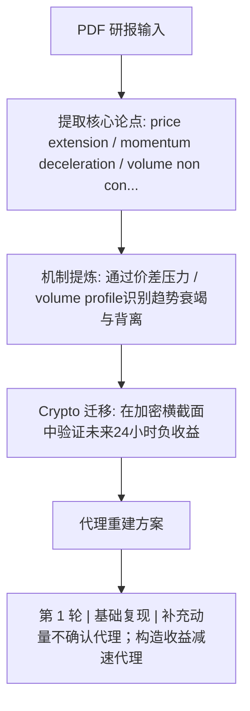
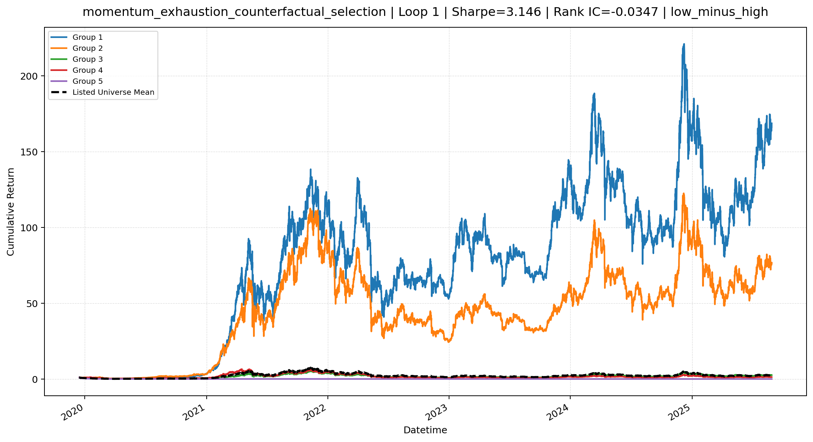
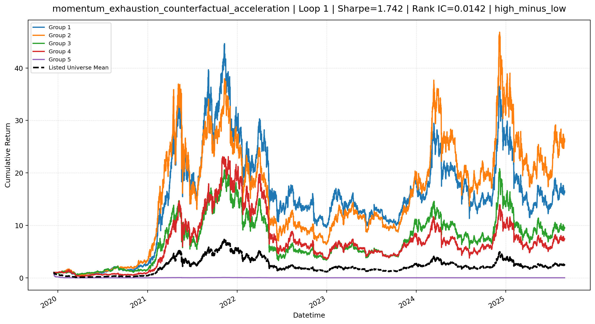
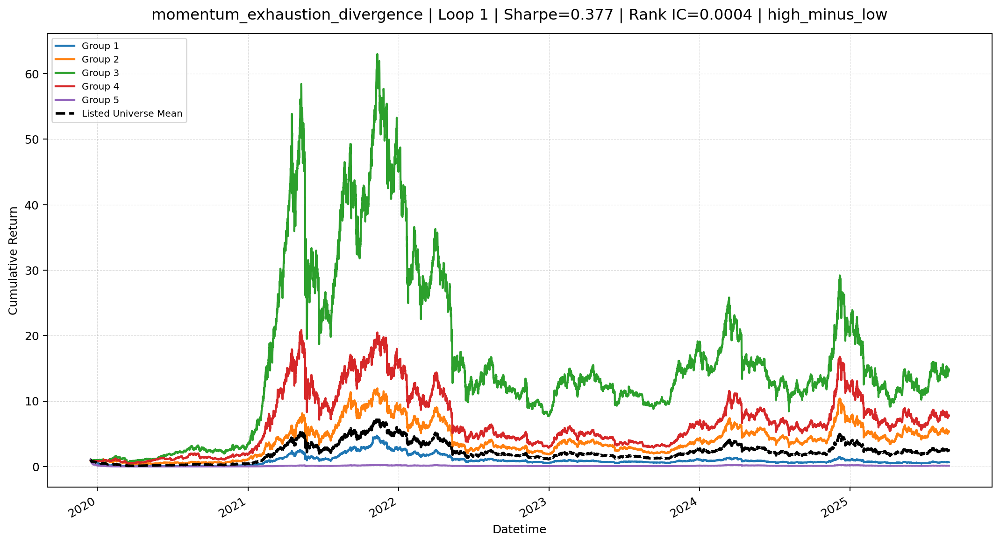

# 因子挖掘研究报告

**生成时间**: 2026-04-28 13:12:32
**日志目录**: `20260428_130128`
**总轮数**: 1
**研报来源**: 20260329-dingbeili.pdf

***

## 0. 总览

本报告以 PDF 研报为起点，展示：

- 研报中抽取出的核心论点与作用机制
- 如何迁移到加密资产横截面场景
- 每一轮假设如何演化
- 每一层实验设计与因子表达式
- 各轮核心指标对比（包含 IC / Rank IC / 夏普 / 回撤 等）
- 报告末尾保留“全部因子表现明细（最终总表）”，逐个展示每个因子的信号强度、方向评价和回测指标

### 0.1 研报抽取摘要

- **研究目标**: 以 未来24小时负收益 为验证方向，围绕「price extension / momentum deceleration / volume non confirmation」构建横截面因子。
- **辅助确认**: 价差压力 / volume profile
- **实际输入特征**: $returns\_24h, $returns\_12h, $close, $volume\_change\_1h, $volume\_change\_24h, $high\_low\_spread
- **已剔除的原市场特有机制**: K-line inclusion processing and pattern segmentation (缠论笔识别), Session-specific timing rules (A-share market hours), Price limit mechanics, T+1 trading constraints

### 0.2 研究流程图



### 0.3 各轮核心指标总表

| 轮次 | 阶段   | 最优因子                         | IC      | Rank IC | ICIR    | Rank ICIR | 夏普     | 回撤     | 覆盖率    | 换手率    |
| -- | ---- | ---------------------------- | ------- | ------- | ------- | --------- | ------ | ------ | ------ | ------ |
| 1  | 基础复现 | momentum\_exhaustion\_counte | -0.0241 | -0.0347 | -0.1185 | -0.1801   | 3.1457 | 0.4599 | 0.9039 | 0.2043 |

### 0.4 Top 3 Sharpe 分层回测图

以下图表按最终方向对齐后的 `sharpe` 选出全报告最佳的 3 个因子。图中使用 5 分组可视化，并沿用 `fwd_returns_4h`、非重叠 4h 采样的口径。
图里的 benchmark 使用所有已上市币种在该时点的等权平均收益累计曲线。
`Group 1` 始终表示与最终 Sharpe 方向一致的理想多头分层，最后一组表示对应空头分层。

**Top 1**: `momentum_exhaustion_counterfactual_selection`（Loop 1，Sharpe=3.145694，Rank IC=-0.034685，方向=`low_minus_high`）



**Top 2**: `momentum_exhaustion_counterfactual_acceleration`（Loop 1，Sharpe=1.742011，Rank IC=0.014184，方向=`high_minus_low`）



**Top 3**: `momentum_exhaustion_divergence`（Loop 1，Sharpe=0.377429，Rank IC=0.000389，方向=`high_minus_low`）



### 0.5 理论内因子 vs 理论外对照

### 0.6 假设演化与信号强弱

| 轮次 | 阶段   | 本轮假设（中文）                                                                                    | 最优因子                       | 最优 Rank IC | 已回测因子 | 弱信号数 | 多数弱信号 | 方向稳定 | 建议动作 | 原因                                                                                  |
| -- | ---- | ------------------------------------------------------------------------------------------- | -------------------------- | ---------- | ----- | ---- | ----- | ---- | ---- | ----------------------------------------------------------------------------------- |
| 1  | 基础复现 | Crypto momentum exhaustion factor: assets where 24h price makes a N-period high while N-pe… | momentum\_exhaustion\_coun | -0.0347    | 3     | 2    | 是     | 否    | 代理重构 | Counterfactual group is moderately stronger than mainline (best \|Rank IC\|=0.0346… |

| 轮次 | 理论内因子数 | 理论内最佳                      | 理论内 Rank IC | 理论外因子数 | 理论外最佳                      | 理论外 Rank IC | 观察                         |
| -- | ------ | -------------------------- | ----------- | ------ | -------------------------- | ----------- | -------------------------- |
| 1  | 1      | momentum\_exhaustion\_dive | 0.0004      | 2      | momentum\_exhaustion\_coun | -0.0347     | 理论外对照绝对 Rank IC 更强，需检查假设方向 |

## 第 1 轮

### 1. 本轮假设

**本轮核心假设**: 围绕「price extension / momentum deceleration / volume non confirmation」构建信号，目标是 未来24小时负收益。

- **因子值与收益预期方向**: 取决于因子编码
- **辅助确认**: 价差压力 / volume profile
- **输入特征**: $returns\_24h, $returns\_12h, $close, $volume\_change\_1h, $volume\_change\_24h, $high\_low\_spread
- **已避免直接照搬**: K-line inclusion processing and pattern segmentation (缠论笔识别), Session-specific timing rules (A-share market hours), Price limit mechanics, T+1 trading constraints

### 2. 本层实验设计

- **Experiment ID**: `original_001_original_001_000`
- **当前阶段**: 基础复现
- **阶段目标**: 本轮处于基础复现阶段，重点是先把研报逻辑用 3 个朴素因子落地验证。
- **本轮生成因子数**: 3
- **理论外对抗因子**: 目标 2 个，实际保留 2 个，用于检验相反经济解释是否更强。
- **复杂度预算**: 本轮未显式设置阶段预算。

### 3. 因子与表达式

**本轮包含理论外对照因子**: 这些因子合法且参与回测，但偏离当前 thesis 锚点，用于判断是否存在更强的替代机制。

#### 因子 1: momentum\_exhaustion\_divergence

**理论归属**: 理论内主线
**Anchor 匹配**: 匹配特征=$close, $returns\_12h, $volume\_change\_1h, $volume\_change\_24h；缺失特征=$high\_low\_spread, $returns\_24h；表达式模式匹配=否
**预期 Anchor 模式**: TS\_RANK($returns\_24h,\*)
**实现状态**: generated
**方向评价**: 预期=负相关；实际 Rank IC 符号=正相关；是否符合=不符合；建议用法=`negate_factor`
**信号强度**: 噪声；|Rank IC|=0.0004；弱信号=是；建议=若长期持续则换假设

**说明**: 本因子为当前阶段自动生成的候选表达式，用于检验该代理在横截面上的预测能力。

**表达式**:

```text
PERCENTILE($close / TS_MAX($close, 24), 0.5, 24) + PERCENTILE($returns_1h / ($returns_12h + 1e-8), 0.5, 12) + RANK(SIGN($returns_1h) * ($volume_change_1h - $volume_change_24h))
```

**指标**:

- **IC**: 0.002153
- **ICIR**: 0.012392
- **Rank IC**: 0.000389
- **Rank ICIR**: 0.002352
- **覆盖率**: 0.903400
- **换手率**: 0.303470
- **夏普**: 0.377429
- **回撤**: 0.886143
- **多空正收益占比**: 0.500800
- **多空平均收益**: 0.000119
- **分层单调性**: 0.500000
- **第1层平均收益**: 0.000078
- **第2层平均收益**: 0.000372
- **第3层平均收益**: 0.000414
- **第4层平均收益**: 0.000342
- **第5层平均收益**: 0.000196
- **raw\_long\_short\_mean\_return**: 0.000119
- **raw\_long\_short\_positive\_ratio**: 0.500800
- **raw\_drawdown**: 0.886143
- **raw\_sharpe**: 0.377429
- **long\_short\_orientation**: 0.000000
- **direction\_aligned\_by\_rank\_ic**: 1.000000
- **IC绝对值**: 0.002153
- **IC方向**: 1.000000
- **Rank IC绝对值**: 0.000389
- **Rank IC方向**: 1.000000
- **ICIR绝对值**: 0.012392
- **夏普绝对值**: 0.377429

**复杂度诊断**:

- **复杂度诊断**: 本因子未记录复杂度结果。

#### 因子 2: momentum\_exhaustion\_counterfactual\_acceleration

**理论归属**: 理论外对照
**反事实批判假设**: Momentum deceleration signals digestion and accumulation, not exhaustion - rapid price movement relative to medium-term trend represents hidden accumulation phase with positive forward returns expected.
**反事实机制**: When price extends with decelerating momentum, institutional accumulation creates the appearance of exhaustion while underlying conviction strengthens. The ratio of short to long returns captures this hidden accumulation pattern before continued price appreciation.
**反事实预期方向**: positive (momentum deceleration predicts continued upside, not reversal)
**Anchor 匹配**: 匹配特征=$close；缺失特征=$high\_low\_spread, $returns\_12h, $returns\_24h, $volume\_change\_1h, $volume\_change\_24h；表达式模式匹配=否
**预期 Anchor 模式**: TS\_RANK($returns\_24h,\*)
**实现状态**: generated
**方向评价**: 预期=负相关；实际 Rank IC 符号=正相关；是否符合=不符合；建议用法=`negate_factor`
**信号强度**: 弱信号；|Rank IC|=0.0142；弱信号=是；建议=修改理论/代理

**说明**: 本因子为当前阶段自动生成的候选表达式，用于检验该代理在横截面上的预测能力。

**表达式**:

```text
RANK(LOG(TS_PCTCHANGE($close, 6) / (TS_PCTCHANGE($close, 24) + 1e-8) + 1e-8)) * RANK(PERCENTILE($close / TS_MAX($close, 24), 0.5, 24))
```

**指标**:

- **IC**: 0.006391
- **ICIR**: 0.034505
- **Rank IC**: 0.014184
- **Rank ICIR**: 0.073232
- **覆盖率**: 0.905500
- **换手率**: 0.153137
- **夏普**: 1.742011
- **回撤**: 0.673687
- **多空正收益占比**: 0.515040
- **多空平均收益**: 0.000537
- **分层单调性**: 0.750000
- **第1层平均收益**: -0.000142
- **第2层平均收益**: 0.000389
- **第3层平均收益**: 0.000390
- **第4层平均收益**: 0.000456
- **第5层平均收益**: 0.000395
- **raw\_long\_short\_mean\_return**: 0.000537
- **raw\_long\_short\_positive\_ratio**: 0.515040
- **raw\_drawdown**: 0.673687
- **raw\_sharpe**: 1.742011
- **long\_short\_orientation**: 0.000000
- **direction\_aligned\_by\_rank\_ic**: 1.000000
- **IC绝对值**: 0.006391
- **IC方向**: 1.000000
- **Rank IC绝对值**: 0.014184
- **Rank IC方向**: 1.000000
- **ICIR绝对值**: 0.034505
- **夏普绝对值**: 1.742011

**复杂度诊断**:

- **复杂度诊断**: 本因子未记录复杂度结果。

#### 因子 3: momentum\_exhaustion\_counterfactual\_selection

**理论归属**: 理论外对照
**反事实批判假设**: Volume non-confirmation is selection bias, not causal mechanism: assets breaking highs with lower volume simply have less speculative interest; this is not mispricing but rational underpricing of lower-interest assets.
**反事实机制**: Assets breaking highs without volume confirm lower retail interest. This selection effect means the signal captures asset heterogeneity rather than momentum exhaustion. Price momentum remains valid predictor while volume divergence only indicates lower conviction assets, not mispricing.
**反事实预期方向**: neutral-to-positive (selection effect, not reversal signal)
**Anchor 匹配**: 匹配特征=$close, $high\_low\_spread, $returns\_12h, $returns\_24h；缺失特征=$volume\_change\_1h, $volume\_change\_24h；表达式模式匹配=否
**预期 Anchor 模式**: TS\_RANK($returns\_24h,\*)
**实现状态**: generated
**方向评价**: 预期=负相关；实际 Rank IC 符号=负相关；是否符合=符合；建议用法=`as_is`
**信号强度**: 中等；|Rank IC|=0.0347；弱信号=否；建议=更换参数

**说明**: 本因子为当前阶段自动生成的候选表达式，用于检验该代理在横截面上的预测能力。

**表达式**:

```text
RANK(TS_PCTCHANGE($close, 4)) + RANK($returns_12h - $returns_24h) + RANK($high_low_spread / TS_MEAN($high_low_spread, 24))
```

**指标**:

- **IC**: -0.024070
- **ICIR**: -0.118480
- **Rank IC**: -0.034685
- **Rank ICIR**: -0.180116
- **覆盖率**: 0.903900
- **换手率**: 0.204342
- **夏普**: 3.145694
- **回撤**: 0.459904
- **多空正收益占比**: 0.544160
- **多空平均收益**: 0.000940
- **分层单调性**: 0.000000
- **第1层平均收益**: 0.000637
- **第2层平均收益**: 0.000553
- **第3层平均收益**: 0.000289
- **第4层平均收益**: 0.000234
- **第5层平均收益**: -0.000303
- **raw\_long\_short\_mean\_return**: -0.000940
- **raw\_long\_short\_positive\_ratio**: 0.455840
- **raw\_drawdown**: 0.999998
- **raw\_sharpe**: -3.145694
- **long\_short\_orientation**: 0.000000
- **direction\_aligned\_by\_rank\_ic**: 1.000000
- **IC绝对值**: 0.024070
- **IC方向**: -1.000000
- **Rank IC绝对值**: 0.034685
- **Rank IC方向**: -1.000000
- **ICIR绝对值**: 0.118480
- **夏普绝对值**: 3.145694

**复杂度诊断**:

- **复杂度诊断**: 本因子未记录复杂度结果。

### 4. 反馈与结论

**弱信号提醒**: 本轮因子 Rank IC 绝对值普遍低于 0.025，建议修改 proxy 或重构假设。
**修订原因**: Counterfactual group is moderately stronger than mainline (best |Rank IC|=0.034685); broaden proxy reconstruction before flipping the thesis.

**语义诊断**: mechanism\_unclear
**假设支持情况**: 不支持
**下一阶段建议**: 基础复现
**最佳单因子**: `momentum_exhaustion_counterfactual_selection`，IC=-0.0241，Rank IC=-0.0347，夏普=3.1457，回撤=0.4599。
**中文结论**: 当前轮需要结合指标与实验设计继续判断。

***

## 总结

### 假设演化总结

**第 1 轮（基础复现）**：Crypto momentum exhaustion factor: assets where 24h price makes a N-period high while N-period returns and volume change decelerate will exhibit negative fwd\_returns\_4h, capturing divergence-based reversal at 4h horizon.
本轮最优因子为 `momentum_exhaustion_counterfactual_selection`，Rank IC=-0.0347。理论内组最佳 |Rank IC|=0.0004，理论外对照组最佳 |Rank IC|=0.0347，判断为“反事实形成中等挑战”，建议动作是“重构代理变量”。
原因：Counterfactual group is moderately stronger than mainline (best |Rank IC|=0.034685); broaden proxy reconstruction before flipping the thesis.

**总体结论**：
本次实验从“Crypto momentum exhaustion factor: assets where 24h price makes a N-period high while N-period returns and volume change decelerate will exhibit negative fwd\_returns\_4h, capturing divergence-based reversal at 4h horizon.”出发，最终演化到“Crypto momentum exhaustion factor: assets where 24h price makes a N-period high while N-period returns and volume change decelerate will exhibit negative fwd\_returns\_4h, capturing divergence-based reversal at 4h horizon.”。如果理论外对照只是 weak/moderate，应优先理解为 proxy 或方向解释受到挑战；只有连续组级胜出并达到 strong 时，才应视为需要 thesis-level 修正。
反事实挑战统计：moderate=1。

### 全部因子表现明细（最终总表）

该表逐个列出所有 loop 生成的因子，用于横向比较信号强弱、方向是否符合预期、是否建议取反，以及核心回测指标。

| 轮次 | 理论归属  | 因子名                              | 信号强度 | 信号建议      | Abs Rank IC | 弱信号 | 预期方向 | Rank IC符号 | 方向符合 | 建议用法            | IC      | Rank IC | ICIR    | Rank ICIR | 夏普     | 回撤     | 覆盖率    | 换手率    |
| -- | ----- | -------------------------------- | ---- | --------- | ----------- | --- | ---- | --------- | ---- | --------------- | ------- | ------- | ------- | --------- | ------ | ------ | ------ | ------ |
| 1  | 理论内主线 | momentum\_exhaustion\_divergence | 噪声   | 若长期持续则换假设 | 0.0004      | 是   | 负相关  | 正相关       | 不符合  | `negate_factor` | 0.0022  | 0.0004  | 0.0124  | 0.0024    | 0.3774 | 0.8861 | 0.9034 | 0.3035 |
| 1  | 理论外对照 | momentum\_exhaustion\_counterfac | 弱信号  | 修改理论/代理   | 0.0142      | 是   | 负相关  | 正相关       | 不符合  | `negate_factor` | 0.0064  | 0.0142  | 0.0345  | 0.0732    | 1.7420 | 0.6737 | 0.9055 | 0.1531 |
| 1  | 理论外对照 | momentum\_exhaustion\_counterfac | 中等   | 更换参数      | 0.0347      | 否   | 负相关  | 负相关       | 符合   | `as_is`         | -0.0241 | -0.0347 | -0.1185 | -0.1801   | 3.1457 | 0.4599 | 0.9039 | 0.2043 |

***

*本报告由 Alpha Factor Mining Report Generator 自动生成（中文版）*
